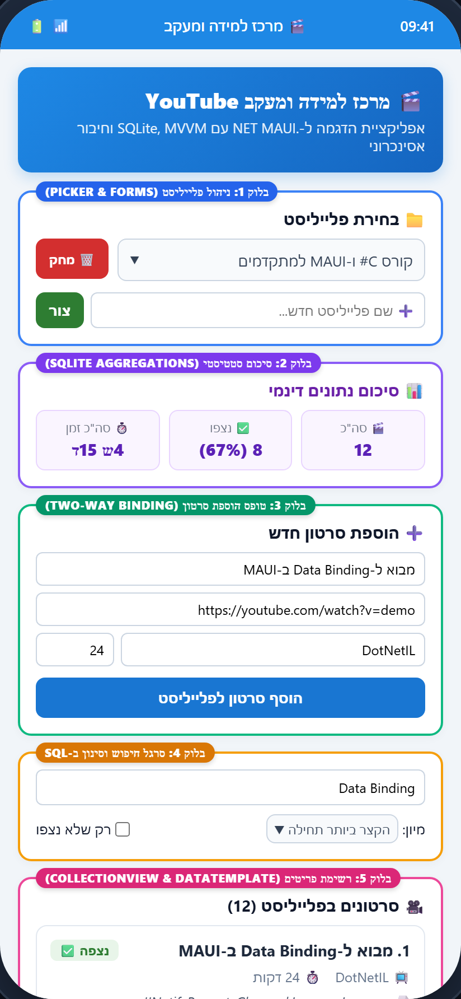
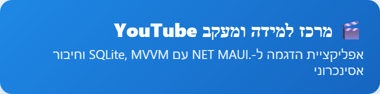
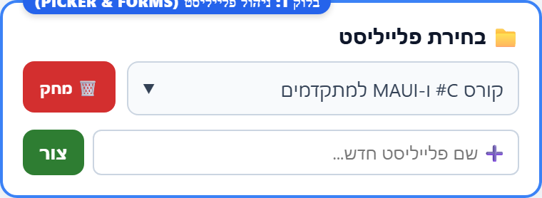
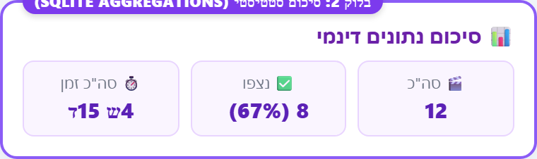
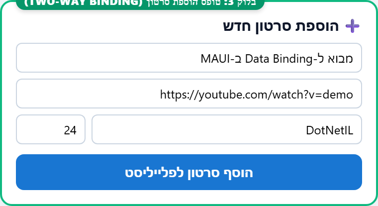
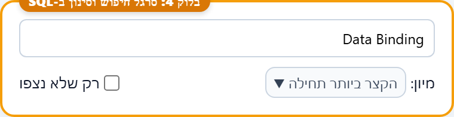
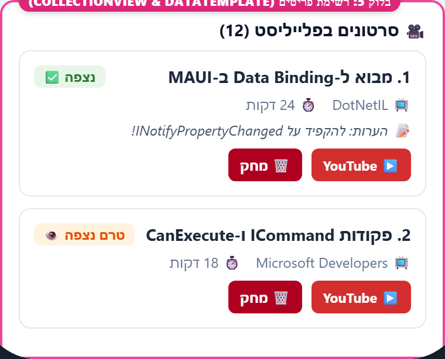

# מדריך פיתוח ממשק: מרכז למידה ומעקב YouTube (MainPage)
> שיטת הבלוקים המודולרית לבניית ממשק משתמש ב-.NET MAUI

---

## 🎯 1. מבוא והשראה עיצובית: בונים מסך ניהול תוכן מתקדם ב-MAUI

שמתם לב פעם באפליקציות המובילות — כמו Spotify, YouTube או Notion — איך מסכים מורכבים שמכילים עשרות פקדים, טפסים, נתונים סטטיסטיים ורשימות נראים מסודרים, ברורים ומזמינים? 
במבט ראשון, מסך כזה עלול להיראות מאיים לתכנות: יש בו בחירת קטגוריה, כרטיסי סיכום מחושבים, טופסי קלט, מנוע חיפוש וסינון, ורשימה דינמית של כרטיסים אינטראקטיביים. 

הסוד של מפתחי מובייל מקצועיים הוא **לא לכתוב קובץ XAML ענק בבת אחת**, אלא לפרק את הממשק ל**בלוקים פונקציונליים עצמאיים**.
במדריך זה נלמד לבנות את מסך ה-`MainPage` של פרויקט **YouTube Hub** צעד-אחר-צעד, באופן מודולרי ונקי, תוך יישום שיטת הבלוקים המודולרית וחיבור מלא ל-MVVM ולמסד נתונים מקומי ב-SQLite!

### 📱 מפת הבלוקים של המסך (Visual Block Architecture)
להלן מפת היעד החזותית של המסך, כפי שחולקה ל-5 בלוקים מרכזיים:



---

## 🧭 2. איך המדריך הזה בנוי? (The Meta-Frame)

כדי שתוכלו להבין כל שורת קוד ולשלוט בממשק ב-100%, נפעל לפי 3 עקרונות פדגוגיים מנחים:
- ➖ **דיאגרמה חזותית מפורקת (Visual Diagram):** חילקנו את המסך לחמישה בלוקים צבעוניים מוגדרים. בכל שלב נתמקד בבלוק אחד בלבד.
- ➖ **קוד מודולרי עם נקודות עוגן (Modular Code with Placeholders):** נתחיל עם שלד הגריד והערות מקום (`<!-- כאן יבוא הבלוק הבא -->`), ונרכיב כל רכיב בנפרד.
- ➖ **התקדמות הדרגתית מלווה בצילומי מסך ממוקדים:** לכל בלוק מוצגת תמונת תוצאה מתוך ההדמיה, לצד פינות העמקה (`Deep-Dive Callouts`) על טכניקות מפתח.

---

## 🔧 3. הכנת סביבת העבודה ומרחבי שמות (Namespaces)

לפני שמתחילים בעיצוב ה-XAML, נוודא שראש הקובץ `MainPage.xaml` כולל את מרחבי השמות (Namespaces) הנדרשים לקישור ה-ViewModel והמודלים, וכן את הגדרת כיוון המסך מימין-לשמאל:

```xml
<?xml version="1.0" encoding="utf-8" ?>
<ContentPage xmlns="http://schemas.microsoft.com/dotnet/2021/maui"
             xmlns:x="http://schemas.microsoft.com/winfx/2009/xaml"
             xmlns:vm="clr-namespace:MauiSkillTester.ViewModels"
             xmlns:models="clr-namespace:MauiSkillTester.Models"
             x:Class="MauiSkillTester.MainPage"
             x:DataType="vm:MainViewModel"
             Title="{Binding Title}"
             FlowDirection="RightToLeft">

    <!-- כאן יבוא שלד הגריד הראשי -->

</ContentPage>
```

> **💡 מדוע הגדרנו `x:DataType="vm:MainViewModel"`?**  
> זהו מנגנון **Compiled Bindings** של .NET MAUI. הוא מאפשר לקומפיילר לבדוק בזמן הידור שכל שדה ופקודה קיימים באמת ב-ViewModel, מונע שגיאות כתיב חבויות, ומשפר את ביצועי האפליקציה בריצה!

---

## 📐 4. אסטרטגיית הבלוקים (The Block Strategy)

### שלב 4.0: שלד הגריד הראשי ומחוון הטעינה (Grid Backbone & Loading)
עמוד השדרה של המסך מורכב מגריד בן 2 שורות:
1. שורה 0 (`Auto`): מיועדת למחוון הטעינה (`ActivityIndicator`).
2. שורה 1 (`*`): אזור הגלילה הראשי (`ScrollView`) המכיל את כל תוכן המסך.

```xml
<Grid RowDefinitions="Auto, *">

    <!-- מחוון טעינה אסינכרוני (ActivityIndicator) -->
    <ActivityIndicator Grid.Row="0"
                       IsRunning="{Binding IsLoading}"
                       IsVisible="{Binding IsLoading}"
                       Color="{StaticResource Primary}"
                       HeightRequest="40"
                       HorizontalOptions="Center"
                       VerticalOptions="Center" />

    <!-- מיכל הגלילה הראשי -->
    <ScrollView Grid.Row="1">
        <VerticalStackLayout Padding="16" Spacing="20">
            <!-- כותרת ראשית (Hero Header) -->
            <!-- בלוק 1: ניהול ובחירת פלייליסט -->
            <!-- בלוק 2: סיכום סטטיסטי של הפלייליסט -->
            <!-- בלוק 3: טופס הוספת סרטון -->
            <!-- בלוק 4: סרגל חיפוש, סינון ומיון ב-SQL -->
            <!-- בלוק 5: רשימת סרטונים דינמית -->
        </VerticalStackLayout>
    </ScrollView>

</Grid>
```

---

### שלב 4.1: כותרת עליונה ובאנר ראשי (Hero Banner)



כרטיס כותרת צבעוני בעל פינות מעוגלות המעניק רושם ראשוני מקצועי:

```xml
<!-- כותרת ראשית ומעוצבת -->
<Border StrokeShape="RoundRectangle 12" 
        BackgroundColor="#1E88E5" 
        Padding="16" 
        StrokeThickness="0">
    <VerticalStackLayout Spacing="6">
        <Label Text="🎬 מרכז למידה ומעקב YouTube"
               FontSize="22"
               FontAttributes="Bold"
               TextColor="White"
               HorizontalOptions="Start" />
        <Label Text="אפליקציית הדגמה ל-.NET MAUI עם SQLite, MVVM וחיבור אסינכרוני"
               FontSize="14"
               TextColor="#E3F2FD"
               HorizontalOptions="Start" />
    </VerticalStackLayout>
</Border>
```

---

### שלב 4.2: בלוק 1 — ניהול ובחירת פלייליסט (Playlist Management)



בלוק זה מאפשר למשתמש לבחור פלייליסט פעיל מתוך בורר (`Picker`), למחוק פלייליסט קיים, או ליצור פלייליסט חדש בטופס מהיר.

```xml
<!-- חלק 1: ניהול ובחירת פלייליסט -->
<Border StrokeShape="RoundRectangle 10" 
        Padding="16" 
        BackgroundColor="{AppThemeBinding Light=#F5F5F5, Dark=#212121}">
    <VerticalStackLayout Spacing="12">
        <Label Text="📁 בחירת פלייליסט" FontSize="18" FontAttributes="Bold" />

        <Grid ColumnDefinitions="*, Auto" ColumnSpacing="10">
            <Picker Grid.Column="0"
                    Title="בחר פלייליסט מהרשימה..."
                    ItemsSource="{Binding Playlists}"
                    ItemDisplayBinding="{Binding Name}"
                    SelectedItem="{Binding SelectedPlaylist}" />

            <Button Grid.Column="1"
                    Text="🗑️ מחק פלייליסט"
                    Command="{Binding DeletePlaylistCommand}"
                    CommandParameter="{Binding SelectedPlaylist}"
                    BackgroundColor="#D32F2F"
                    TextColor="White" />
        </Grid>

        <!-- קו מפריד וטופס יצירת פלייליסט חדש -->
        <BoxView HeightRequest="1" Color="#CCCCCC" Margin="0,4" />
        <Label Text="➕ יצירת פלייליסט חדש" FontSize="15" FontAttributes="Bold" />
        
        <Grid RowDefinitions="Auto, Auto"
              ColumnDefinitions="*, Auto"
              RowSpacing="8"
              ColumnSpacing="10">
            <Entry Grid.Row="0"
                   Grid.Column="0"
                   Grid.ColumnSpan="2"
                   Placeholder="שם הפלייליסט החדש (חובה)"
                   Text="{Binding NewPlaylistName}" />

            <Entry Grid.Row="1"
                   Grid.Column="0"
                   Placeholder="תיאור הפלייליסט (אופציונלי)"
                   Text="{Binding NewPlaylistDescription}" />

            <Button Grid.Row="1"
                    Grid.Column="1"
                    Text="צור פלייליסט"
                    Command="{Binding AddPlaylistCommand}"
                    BackgroundColor="#2E7D32"
                    TextColor="White" />
        </Grid>
    </VerticalStackLayout>
</Border>
```

---

### שלב 4.3: בלוק 2 — סיכום סטטיסטי מחושב (SQLite Aggregations)



בלוק זה מוצג רק כאשר נבחר פלייליסט (`IsVisible="{Binding HasStats}"`). הוא מציג שלושה כרטיסי סיכום מעוצבים בתוך גריד של 3 עמודות שוות:

```xml
<!-- חלק 2: סיכום סטטיסטי של הפלייליסט (SQLite Aggregations) -->
<Border StrokeShape="RoundRectangle 10"
        Padding="14"
        BackgroundColor="{AppThemeBinding Light=#EDE7F6, Dark=#311B92}"
        IsVisible="{Binding HasStats}">
    <VerticalStackLayout Spacing="8">
        <Label Text="📊 סיכום סטטיסטי (SQLite Aggregations)"
               FontSize="15"
               FontAttributes="Bold"
               TextColor="{AppThemeBinding Light=#4A148C, Dark=#E1BEE7}" />

        <Grid ColumnDefinitions="*, *, *" ColumnSpacing="8">
            <!-- כרטיס 1: סה"כ סרטונים -->
            <Border StrokeShape="RoundRectangle 8"
                    BackgroundColor="{AppThemeBinding Light=White, Dark=#4527A0}"
                    Padding="8">
                <VerticalStackLayout HorizontalOptions="Center" Spacing="2">
                    <Label Text="🎬 סה&quot;כ"
                           FontSize="11"
                           TextColor="Gray"
                           HorizontalOptions="Center" />
                    <Label Text="{Binding CurrentPlaylistStats.TotalVideos}"
                           FontSize="18"
                           FontAttributes="Bold"
                           HorizontalOptions="Center" />
                </VerticalStackLayout>
            </Border>

            <!-- כרטיס 2: סרטונים שנצפו ואחוז השלמה -->
            <Border StrokeShape="RoundRectangle 8"
                    BackgroundColor="{AppThemeBinding Light=White, Dark=#4527A0}"
                    Padding="8">
                <VerticalStackLayout HorizontalOptions="Center" Spacing="2">
                    <Label Text="✅ נצפו"
                           FontSize="11"
                           TextColor="Gray"
                           HorizontalOptions="Center" />
                    <Label Text="{Binding CurrentPlaylistStats.WatchedVideos, StringFormat='{0} סרטונים'}"
                           FontSize="13"
                           FontAttributes="Bold"
                           HorizontalOptions="Center" />
                    <Label Text="{Binding CurrentPlaylistStats.CompletionPercentage, StringFormat='({0}%)'}"
                           FontSize="11"
                           TextColor="#2E7D32"
                           HorizontalOptions="Center" />
                </VerticalStackLayout>
            </Border>

            <!-- כרטיס 3: סך דקות צפייה -->
            <Border StrokeShape="RoundRectangle 8"
                    BackgroundColor="{AppThemeBinding Light=White, Dark=#4527A0}"
                    Padding="8">
                <VerticalStackLayout HorizontalOptions="Center" Spacing="2">
                    <Label Text="⏱️ סה&quot;כ זמן"
                           FontSize="11"
                           TextColor="Gray"
                           HorizontalOptions="Center" />
                    <Label Text="{Binding CurrentPlaylistStats.FormattedTotalDuration}"
                           FontSize="13"
                           FontAttributes="Bold"
                           HorizontalOptions="Center" />
                </VerticalStackLayout>
            </Border>
        </Grid>
    </VerticalStackLayout>
</Border>
```

---

### שלב 4.4: בלוק 3 — טופס הוספת סרטון לפלייליסט (Add Video Form)



בלוק זה מכיל שדות קלט מותאמים עם סוג מקלדת ייעודי (`Keyboard="Url"` ו-`Keyboard="Numeric"`):

```xml
<!-- חלק 3: טופס הוספת סרטון לפלייליסט הנבחר -->
<Border StrokeShape="RoundRectangle 10"
        Padding="16"
        BackgroundColor="{AppThemeBinding Light=#FAFAFA, Dark=#1E1E1E}"
        IsVisible="{Binding HasSelectedPlaylist}">
    <VerticalStackLayout Spacing="10">
        <Label Text="➕ הוספת סרטון לפלייליסט הנוכחי"
               FontSize="18"
               FontAttributes="Bold" />

        <Entry Placeholder="כותרת הסרטון (חובה)"
               Text="{Binding NewVideoTitle}" />

        <Entry Placeholder="קישור URL לסרטון ב-YouTube (חובה)"
               Text="{Binding NewVideoUrl}"
               Keyboard="Url" />
        
        <Grid ColumnDefinitions="*, *" ColumnSpacing="10">
            <Entry Grid.Column="0"
                   Placeholder="שם הערוץ"
                   Text="{Binding NewVideoChannel}" />

            <Entry Grid.Column="1"
                   Placeholder="משך בדקות"
                   Text="{Binding NewVideoDuration}"
                   Keyboard="Numeric" />
        </Grid>

        <Entry Placeholder="הערות אישיות על הסרטון"
               Text="{Binding NewVideoNotes}" />

        <Button Text="הוסף סרטון לפלייליסט"
                Command="{Binding AddVideoCommand}"
                BackgroundColor="#1976D2"
                TextColor="White"
                FontAttributes="Bold"
                Margin="0,6,0,0" />
    </VerticalStackLayout>
</Border>
```

---

### שלב 4.5: בלוק 4 — סרגל חיפוש, מיון וסינון ב-SQL (Filter Bar)



בלוק זה משלב שדה חיפוש בזמן אמת, תיבת סימון (CheckBox) לסינון פריטים שלא נצפו, ותיבת בחירה (Picker) למיון:

```xml
<!-- חלק 4: סרגל חיפוש, סינון ומיון ב-SQL -->
<Border StrokeShape="RoundRectangle 10"
        Padding="14"
        BackgroundColor="{AppThemeBinding Light=#ECEFF1, Dark=#263238}"
        IsVisible="{Binding HasSelectedPlaylist}">
    <VerticalStackLayout Spacing="10">
        <Entry Placeholder="🔍 חפש לפי כותרת, ערוץ או הערות..."
               Text="{Binding SearchQuery}" />

        <Grid ColumnDefinitions="*, Auto"
              ColumnSpacing="12"
              VerticalOptions="Center">
            <!-- בורר אפשרויות מיון -->
            <HorizontalStackLayout Grid.Column="0"
                                   Spacing="6"
                                   VerticalOptions="Center">
                <Label Text="מיון:"
                       VerticalOptions="Center"
                       FontSize="13"
                       TextColor="Gray" />
                <Picker Title="בחר מיון..."
                        ItemsSource="{Binding AvailableSortOptions}"
                        ItemDisplayBinding="{Binding DisplayName}"
                        SelectedItem="{Binding SelectedSortOptionItem}"
                        FontSize="13"
                        HorizontalOptions="Fill" />
            </HorizontalStackLayout>

            <!-- סינון רק שלא נצפו -->
            <HorizontalStackLayout Grid.Column="1"
                                   Spacing="4"
                                   VerticalOptions="Center">
                <CheckBox IsChecked="{Binding ShowOnlyUnwatched}"
                          VerticalOptions="Center" />
                <Label Text="רק שלא נצפו"
                       VerticalOptions="Center"
                       FontSize="13" />
            </HorizontalStackLayout>
        </Grid>
    </VerticalStackLayout>
</Border>
```

---

### שלב 4.6: בלוק 5 — רשימת כרטיסים דינמית (CollectionView & DataTemplate)



בלוק זה מציג את כרטיסי הסרטונים. כל כרטיס כולל `DataTrigger` לשינוי מצב כפתור הצפייה וכפתור לפתיחת הסרטון באפליקציית YouTube החיצונית:

```xml
<!-- חלק 5: רשימת סרטונים (CollectionView) -->
<VerticalStackLayout Spacing="10" IsVisible="{Binding HasSelectedPlaylist}">
    <Label Text="🎥 סרטונים בפלייליסט" FontSize="18" FontAttributes="Bold" />

    <CollectionView ItemsSource="{Binding Videos}" SelectionMode="None">
        <!-- תצוגה כאשר הרשימה ריקה -->
        <CollectionView.EmptyView>
            <VerticalStackLayout Padding="30" HorizontalOptions="Center" Spacing="10">
                <Label Text="📭 אין סרטונים להצגה בפלייליסט זה" FontSize="16" HorizontalOptions="Center" TextColor="Gray" />
                <Label Text="השתמש בטופס למעלה כדי להוסיף סרטונים חדשים!" FontSize="13" HorizontalOptions="Center" TextColor="Gray" />
            </VerticalStackLayout>
        </CollectionView.EmptyView>

        <!-- תבנית הפריט הבודד -->
        <CollectionView.ItemTemplate>
            <DataTemplate x:DataType="models:VideoItem">
                <Border StrokeShape="RoundRectangle 8"
                        Margin="0,0,0,10"
                        Padding="14"
                        BackgroundColor="{AppThemeBinding Light=White, Dark=#2D2D2D}"
                        StrokeThickness="1"
                        Stroke="#E0E0E0">
                    <Grid RowDefinitions="Auto, Auto, Auto" ColumnDefinitions="*, Auto" RowSpacing="6">

                        <!-- כותרת, ערוץ וזמן -->
                        <VerticalStackLayout Grid.Row="0" Grid.Column="0" Spacing="2">
                            <Label Text="{Binding Title}"
                                   FontSize="16"
                                   FontAttributes="Bold"
                                   LineBreakMode="TailTruncation" />
                            <HorizontalStackLayout Spacing="12">
                                <Label Text="{Binding ChannelName, StringFormat='📺 ערוץ: {0}'}"
                                       FontSize="13"
                                       TextColor="Gray" />
                                <Label Text="{Binding FormattedDuration, StringFormat='⏱️ {0}'}"
                                       FontSize="13"
                                       TextColor="Gray" />
                            </HorizontalStackLayout>
                        </VerticalStackLayout>

                        <!-- כפתור מצב צפייה עם DataTrigger -->
                        <Button Grid.Row="0"
                                Grid.Column="1"
                                Text="טרם נצפה 👁️"
                                Command="{Binding BindingContext.ToggleWatchedCommand,
                                                  Source={RelativeSource AncestorType={x:Type ContentPage}}}"
                                CommandParameter="{Binding .}"
                                FontSize="12"
                                HeightRequest="36"
                                Padding="8,2"
                                BackgroundColor="#FFF3E0"
                                TextColor="#E65100">
                            <Button.Triggers>
                                <DataTrigger TargetType="Button"
                                             Binding="{Binding IsWatched}"
                                             Value="True">
                                    <Setter Property="Text" Value="נצפה ✅" />
                                    <Setter Property="BackgroundColor" Value="#E8F5E9" />
                                    <Setter Property="TextColor" Value="#2E7D32" />
                                </DataTrigger>
                            </Button.Triggers>
                        </Button>

                        <!-- הערות אישיות -->
                        <Label Grid.Row="1"
                               Grid.Column="0"
                               Grid.ColumnSpan="2"
                               Text="{Binding Notes, StringFormat='📝 הערות: {0}'}"
                               FontSize="13"
                               FontAttributes="Italic"
                               TextColor="#555555" />

                        <!-- כפתורי פעולה: נגן ומחק -->
                        <HorizontalStackLayout Grid.Row="2"
                                               Grid.Column="0"
                                               Grid.ColumnSpan="2"
                                               Spacing="10"
                                               Margin="0,6,0,0">
                            <Button Text="▶️ צפה ב-YouTube (Launcher)"
                                    Command="{Binding BindingContext.OpenVideoUrlCommand,
                                                      Source={RelativeSource AncestorType={x:Type ContentPage}}}"
                                    CommandParameter="{Binding .}"
                                    BackgroundColor="#FF0000"
                                    TextColor="White"
                                    FontSize="13"
                                    HeightRequest="36"
                                    Padding="12,0" />

                            <Button Text="🗑️ מחק סרטון"
                                    Command="{Binding BindingContext.DeleteVideoCommand,
                                                      Source={RelativeSource AncestorType={x:Type ContentPage}}}"
                                    CommandParameter="{Binding .}"
                                    BackgroundColor="#B00020"
                                    TextColor="White"
                                    FontSize="13"
                                    HeightRequest="36"
                                    Padding="12,0" />
                        </HorizontalStackLayout>

                    </Grid>
                </Border>
            </DataTemplate>
        </CollectionView.ItemTemplate>
    </CollectionView>
</VerticalStackLayout>
```

---

## ✍️ 5. פינות העמקה והבנה מושגית (Deep-Dive Callouts)

> [!TIP]
> ### 🔍 1. למה משתמשים ב-`Border` עם `StrokeShape` במקום ב-`Frame`?
> בגרסאות ישנות של Xamarin.Forms השתמשו ב-`Frame`. ב-.NET MAUI, הרכיב המומלץ והביצועי ביותר הוא **`Border`**.
> הוא מאפשר שליטה מדויקת ברדיוס הפינות בעזרת `RoundRectangle`, מסגרת נקייה (`StrokeThickness="0"`), וביצועי רינדור מהירים בהרבה ללא שכבות מיותרות!
>
> 🔗 תיעוד רשמי: [Microsoft Learn - .NET MAUI Border](https://learn.microsoft.com/dotnet/maui/user-interface/controls/border)

> [!TIP]
> ### 🔍 2. איך כפתור בתוך `DataTemplate` מפעיל פקודה ב-ViewModel של הדף?
> בתוך `ItemTemplate`, ה-BindingContext של הפריט הוא אובייקט מסוג `VideoItem` (ולא ה-`MainViewModel`).
> לכן, אם נכתוב סתם `Command="{Binding DeleteVideoCommand}"`, התוכנית לא תמצא את הפקודה!
> הפתרון הוא להשתמש ב-**`RelativeSource`**:
> ```xml
> Command="{Binding BindingContext.DeleteVideoCommand, Source={RelativeSource AncestorType={x:Type ContentPage}}}"
> CommandParameter="{Binding .}"
> ```
> הוראה זו מורה ל-MAUI: *"טפס במעלה עץ הפקדים עד שתגיע ל-ContentPage, קח את ה-BindingContext שלו (ה-ViewModel), והפעל את הפקודה עם הפריט הנוכחי (`Binding .`)"*.
>
> 🔗 תיעוד רשמי: [Microsoft Learn - Relative Bindings in MAUI](https://learn.microsoft.com/dotnet/maui/fundamentals/data-binding/relative-bindings)

> [!TIP]
> ### 🔍 3. התאמה אוטומטית למצב בהיר וכהה (`AppThemeBinding`)
> שימו לב לקוד: `BackgroundColor="{AppThemeBinding Light=#F5F5F5, Dark=#212121}"`.
> בעזרת מנגנון זה, האפליקציה מחליפה צבעים אוטומטית כשהמשתמש משנה את מצב המכשיר שלו בין Dark Mode ל-Light Mode — ללא צורך בכתיבת קוד C# נוסף!
>
> 🔗 תיעוד רשמי: [Microsoft Learn - App Theme Binding](https://learn.microsoft.com/dotnet/maui/user-interface/theming)

---

## 🔌 6. ארכיטקטורת MVVM וחיבור הנתונים (ViewModel & Commands)

כדי לתמוך בכל העושר הוויזואלי שבנינו, ה-`MainViewModel` מנהל את המצב בצורה נקייה וסדורה:

### 1. ניהול שדות ותכונות עם `OnPropertyChanged`
כל תכונה מקושרת לשדה פרטי (`backing field`), ומעדכנת את התצוגה רק בעת שינוי ערך אמיתי:

```csharp
private Playlist? _selectedPlaylist;
public Playlist? SelectedPlaylist
{
    get => _selectedPlaylist;
    set
    {
        if (_selectedPlaylist != value)
        {
            _selectedPlaylist = value;
            OnPropertyChanged();
            OnPropertyChanged(nameof(HasSelectedPlaylist));
            _ = OnSelectedPlaylistChangedAsync();
        }
    }
}
```

### 2. עקרון פיתוח מקצועי: הגנה על פקודות באמצעות `CanExecute`
במקום להדליק ולכבות כפתורים בצורה ידנית ב-Code-Behind, אנו מגדירים תנאי ביצוע ישירות בפקודה:

```csharp
AddVideoCommand = new Command(
    async () => await AddVideoAsync(),
    () => HasSelectedPlaylist && !IsLoading && !string.IsNullOrWhiteSpace(NewVideoTitle)
);
```

כאשר משתנה הסטטוס (`HasSelectedPlaylist` או `IsLoading`), אנו מפעילים:
```csharp
((Command)AddVideoCommand).ChangeCanExecute();
```
כך ה-Button ב-XAML מתעדכן ומנטרל את עצמו אוטומטית!

### 3. שימוש ב-Launcher לפתיחת קישורים חיצוניים
כאשר המשתמש לוחץ על כפתור ה-YouTube, ה-ViewModel מתקשר עם מערכת ההפעלה באופן בטוח:

```csharp
private async Task OpenVideoUrlAsync(VideoItem? video)
{
    if (video == null || string.IsNullOrWhiteSpace(video.Url)) return;

    if (Uri.TryCreate(video.Url, UriKind.Absolute, out var uri))
    {
        await Launcher.Default.OpenAsync(uri);
    }
}
```

---

## ❓ 7. שאלות חזרה, הבנה ואתגר חשיבה

### ⚖️ חלק א': דילמת ארכיטקטורה ועיצוב (Architectural Dilemma)

**הדילמה: איפה לבצע חישובי סיכום — במסד הנתונים (SQL) או בזיכרון (C#)?**  
במסך שלנו יצרנו כרטיסי סיכום סטטיסטיים (סה"כ סרטונים, נצפו, וסך דקות).  
- **גישה א':** לשלוף את כל רשימת הסרטונים ל-C# ולהפעיל `Videos.Count()`, `Videos.Where(v => v.IsWatched).Count()`, `Videos.Sum(v => v.DurationMinutes)`.
- **גישה ב':** לשלוח שאילתת אגרגציה ממוקדת ל-SQLite (`SELECT COUNT(*), SUM(DurationMinutes)...`) המחזירה רק את הערכים המספריים.

> [!TIP]
> **שיקולי החלטה למפתח:**
> - **ביצועים:** כאשר בפלייליסט יש מאות או אלפי סרטונים, גישה א' טוענת אובייקטים כבדים לזיכרון ה-RAM ומאטה את המכשיר. גישה ב' מנצלת את מנוע ה-C של SQLite ומחזירה תשובה במיקרו-שנייה.
> - **תזמון:** גישה ב' עדיפה תמיד כשאנו זקוקים לסיכום בלבד ללא הצגת כל הפריטים.

---

### 🧠 חלק ב': שאלות הבנה מעמיקות עם רמזי הכוונה

1. **מדוע הגדרנו שורה בגובה `*` עבור אזור הגלילה הראשי (`ScrollView`) במקום לקבוע גובה קבוע במספרים (למשל `HeightRequest="600"`)?**
   > [!TIP]
   > **רמז לחשיבה:** חשבו על מכשירי סמארטפון בעלי גדלי מסך שונים — ממסך 5.5 אינץ' ועד טאבלט 12 אינץ'. מה קורה כאשר מגדירים גובה קשיח?

2. **מה תפקידו של `RelativeSource AncestorType={x:Type ContentPage}` בכפתור המחיקה שבתוך ה-`DataTemplate`?**
   > [!TIP]
   > **רמז לחשיבה:** מי ה-`BindingContext` של השורה הבודדת בתוך הרשימה? האם לפריט בודד מסוג `VideoItem` יש פקודת `DeleteVideoCommand`?

3. **כיצד מנגנון ה-`AppThemeBinding` עוזר לשמור על חוויית משתמש נגישה במצב כהה (Dark Mode)?**
   > [!TIP]
   > **רמז לחשיבה:** נסו לחשוב מה קורה לטקסט שחור כאשר רקע הכרטיס מוגדר קשיח כ-`White` במכשיר המוגדר כ-Dark Theme.

---

### 🛠️ חלק ג': אתגר מעשי קצר לתלמיד (Mini-Challenge)

**המשימה:**  
הוסיפו כרטיס סטטיסטי רביעי בבלוק 2 המציג את **זמן הצפייה הממוצע** לסרטון בפלייליסט (בדקות).

**שלבי יישום מודרכים:**
1. **שכבת ה-Model / DTO (`PlaylistStats.cs`):**
   הוסיפו תכונה מחושבת:
   ```csharp
   public double AverageDurationMinutes =>
       TotalVideos > 0 ? Math.Round((double)TotalDurationMinutes / TotalVideos, 1) : 0;
   ```
2. **שכבת ה-XAML (`MainPage.xaml`):**
   שנו את הגריד של בלוק 2 מ-`ColumnDefinitions="*, *, *"` ל-`ColumnDefinitions="*, *, *, *"`, והוסיפו עמודה רביעית:
   ```xml
    <!-- כרטיס 4: ממוצע דקות לסרטון -->
    <Border Grid.Column="3"
            StrokeShape="RoundRectangle 8"
            BackgroundColor="{AppThemeBinding Light=White, Dark=#4527A0}"
            Padding="8">
        <VerticalStackLayout HorizontalOptions="Center" Spacing="2">
            <Label Text="📈 ממוצע"
                   FontSize="11"
                   TextColor="Gray"
                   HorizontalOptions="Center" />
            <Label Text="{Binding CurrentPlaylistStats.AverageDurationMinutes, StringFormat='{0} דק'''}"
                   FontSize="13"
                   FontAttributes="Bold"
                   HorizontalOptions="Center" />
        </VerticalStackLayout>
    </Border>
    ```
3. **אימות:** הריצו את האפליקציה, בחרו פלייליסט וודאו שהכרטיס הרביעי מציג את הממוצע המחושב בצורה תקינה.

---

## 📖 נספח: מקורות השראה, תיעוד וביבליוגרפיה

<div style="font-size: 9.5pt; color: #64748b; line-height: 1.6; border-top: 1px solid #e2e8f0; padding-top: 14px; margin-top: 24px;">
מדריך זה נבנה בהשראת מתודולוגיית הפירוק המודולרי של ממשקי מובייל (The Block Strategy) כפי שפותחה ע"י <strong>Leomaris Reyes</strong> (Microsoft MVP, יוצרת AskXammy.com וכותבת סדרת מאמרי ממשק ב-Telerik).<br>
תיעוד רשמי ומקורות נוספים להעמקה:
<ul style="margin-top: 6px; padding-right: 20px;">
  <li>Microsoft Learn: <a href="https://learn.microsoft.com/dotnet/maui/">מדריך הפיתוח הרשמי ל-.NET MAUI</a></li>
  <li>Microsoft Learn: <a href="https://learn.microsoft.com/dotnet/maui/fundamentals/data-binding/">עקרונות Data Binding וארכיטקטורת MVVM</a></li>
  <li>Microsoft Learn: <a href="https://learn.microsoft.com/dotnet/maui/user-interface/controls/border">שימוש ברכיב ה-Border ועיגול פינות עם StrokeShape</a></li>
  <li>Microsoft Learn: <a href="https://learn.microsoft.com/dotnet/maui/data-cloud/database-sqlite">עבודה עם מסדי נתונים מקומיים ב-SQLite</a></li>
</ul>
</div>
